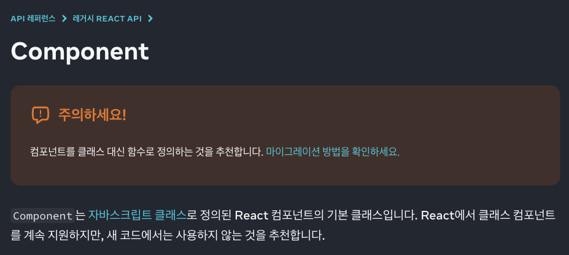
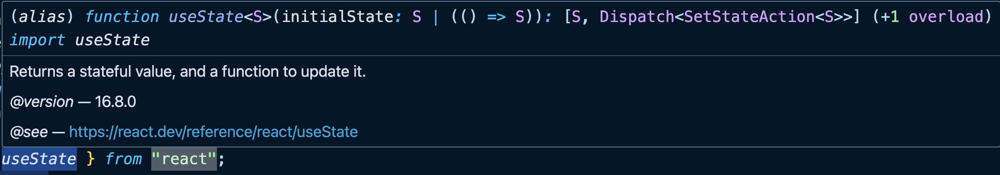
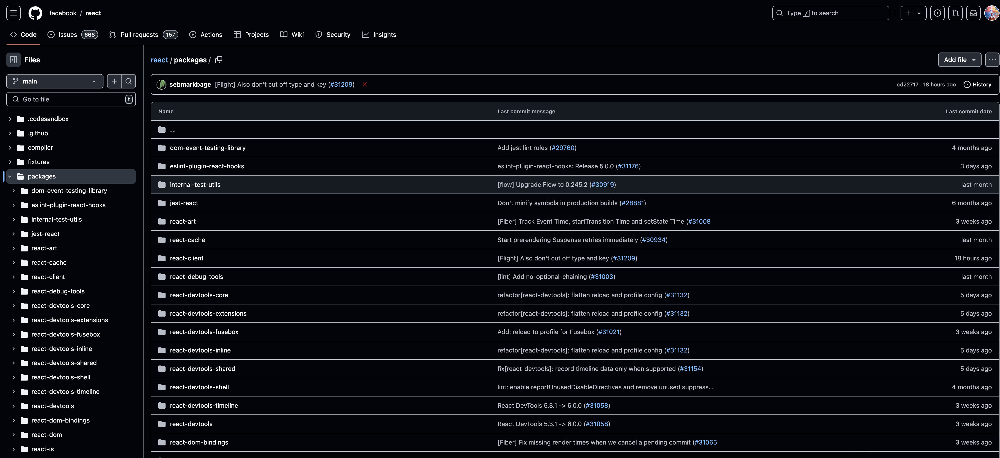
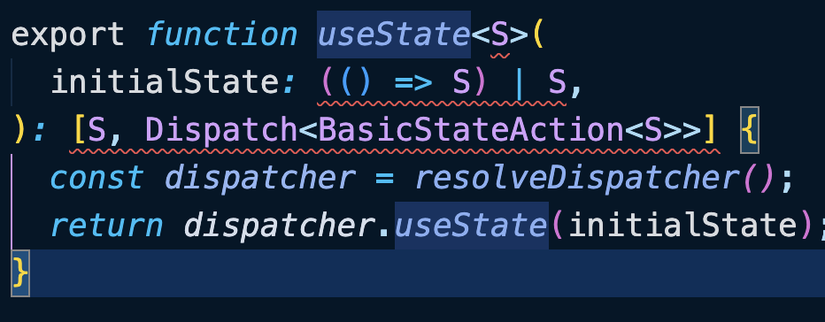
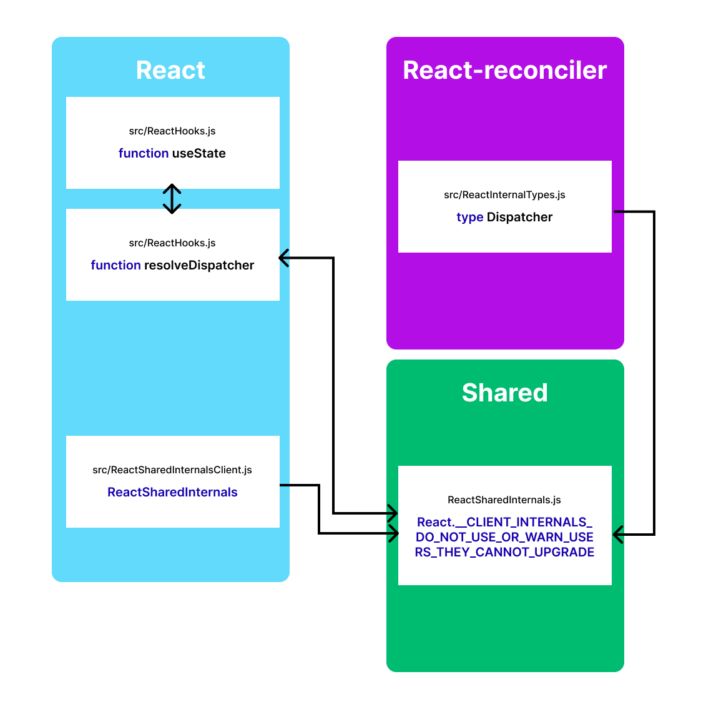

<Heading type="h2">React Hooks 톺아보기</Heading>

오픈소스를 만들어보기 전 **오픈소스 뜯어보기 프로젝트** 첫번째 `React hook` 들을 모두 까보기로 하였다.
유튜브를 보니 오픈소스는 일단 따라가 보는거더라 `*Let's get it*`

<Heading type="h3">useState</Heading>

`useState`는 컴포넌트의 상태를 관리해주고 업데이트 마다 UI를 리렌더링 시켜주며 간단하가
상태를 관리할 수 있게 해준다. 그게 지금 `useState`를 까보는 이유다. 알고 싶으니까

<Heading type="h4">useState 정의</Heading>

<Blockquote>
  useState는 컴포넌트에 state 변수를 추가할 수 있는 React Hook입니다.
  <br />
  -[React](https://ko.react.dev/reference/react/useState)
</Blockquote>

이는 React에서 설명하는 `useState`의 정의이고
좀 더 추가해보면 `react`의 함수형 컴포넌트에서 상태를 관리하는 `Hook`으로 설명할 수 있을 것 같다.

<Heading type="h4">Hook이란?</Heading>

`Hook`이란 React가 **Ver.16.8.0**으로 업데이트 되면서 **함수형 컴포넌트**의 등장! 그로인해 기존의 Class형 컴포넌트에서 관리하던 **생명주기 기능(lifecycle features)**을 **“연동(hook into)“**를 도와주는 로직

<Heading type="h4">클래스 컴포넌트와 함수형 컴포넌트의 상태(state)</Heading>

설명했듯이 `useState`는 함수형 컴포넌트에서 **상태(state)** 관리를 도와주는 `Hook`이다.
함수형 컴포넌트가 나오기 전 클래스 컴포넌트는 어떻게 상태관리를 했을까?

```jsx
// Class Component
class App extends React.Component {
  // 생성자(constructor)
  constructor(props) {
    super(props);
    // 초기 상태(state)
    this.state = {
      count: 0,
    };
  }

  render() {
    // state 불러오기
    const { count } = this.state;
    return (
      <>
        <div>{count}</div>
        <button onClick={() => this.setState({ count: count + 1 })}>
          증가
        </button>
      </>
    );
  }
}
```

아래는 함수형 component

```tsx
export default function App() {
  // useState 호출
  const [count, setCount] = useState<number>(0);

  function handleIncrease() {
    setCount(count + 1);
  }

  return (
    <>
      <div>{count}</div>
      <button onClick={() => this.setState({ count: count + 1 })}>증가</button>
    </>
  );
}
```

그냥 보기에도 편해보인다. `useState`안에서 `state`와 `setState` 모두 가져올 수 있다.



하지만 공식문서에서도 함수형 컴포넌트를 권장하고 있으니 걱정할 필요는 없을 것 같다.

<Heading type="h4">원리</Heading>

이제 코드를 탐험해 보면서 어떤 원리로 움직이는지 확인해보자. (...두려워)



```ts
/**
 * Returns a stateful value, and a function to update it.
 *
 * @version 16.8.0
 * @see https://react.dev/reference/react/useState
 */
function useState<S>(
  initialState: S | (() => S)
): [S, Dispatch<SetStateAction<S>>];
// convenience overload when first argument is omitted
/**
 * Returns a stateful value, and a function to update it.
 *
 * @version 16.8.0
 * @see https://react.dev/reference/react/useState
 */
function useState<S = undefined>(): [
  S | undefined,
  Dispatch<SetStateAction<S | undefined>>
];
```

잉?
아..!
`typescript`를 사용해서 `import` 했더니 `d.ts` 파일로 타입정의만 되어있다.

타입설명을 보면 Ver16.8.0부터 있었고 상태값과 그것을 업데이트하는 함수를 반환한다고 적혀 있다.
`S`는 `state`라는 뜻이다. `initialState`에는 `state`나 `state`를 처리하는 함수를 인자로 받고 `S(상태)`와 `Dispatch<SetStateAction<S>>`를 반환한다. 아래는 첫 번째 인수가 생략된 경우 편의성 과부하를 위해 정의되어있다.

나는 동작원리를 원하니 이제 진짜 코드를 뜯어보자.

뭘까..... 이 무서운 repo는.
`useState`를 찾아보자



packages/react/src/ReactHook.js

찾았다.ㅋㅋ `d.ts` 파일에 있던 타입정의와 비슷한데 `js`파일에서 어떻게 한건지는 모르겠다.

타입정의에 나와 있듯이 `initialState`로 `S(state)` 혹은 `()=> S`를 인자로 받고 `S(state)`와 `Dispatch<BasicStateActrion<S>>`를 배열로 감싸서 반환한다.

```ts
const dispatcher = resolveDispatcher();
return dispatcher.useState(initialState);
```

`dispatcher`안에 `useState(initialState)`가 `[S, Dispatch<BasicStateAction<S>>]`를 반환한다는 것 같은데 `dispatcher`를 반환하는 `resolveDispatcher` 함수를 찾아가 보자.

```ts
function resolveDispatcher() {
  const dispatcher = ReactSharedInternals.H;
 ...

  // Will result in a null access error if accessed outside render phase. We
  // intentionally don't throw our own error because this is in a hot path.
  // Also helps ensure this is inlined.
  return ((dispatcher: any): Dispatcher);
}
```

같은 폴더 안에 있었다.
`ReactSharedInternals`라는 객체에서 `H`를 가져와서 사용하는 것으로 보인다. `H`는 `Hook`일 것이다.

`ReactSharedInternals.H`를 반환하므로 `ReactSharedInternals`를 어디서 가져오는지 봐야겠다.
`ReactSharedInternals`를 찾아보자.

```ts
import ReactSharedInternals from "shared/ReactSharedInternals";
```

**shared** 폴더 안에 있다.

```ts
//shared/ReactSharedInternals,js
import * as React from "react";

const ReactSharedInternals =
  React.__CLIENT_INTERNALS_DO_NOT_USE_OR_WARN_USERS_THEY_CANNOT_UPGRADE;

export default ReactSharedInternals;
```

**??**

React를 전체 불러와서 `__CLIENT_INTERNALS_DO_NOT_USE_OR_WARN_USERS_THEY_CANNOT_UPGRADE`라는 값을 사용한다.

직역하면 "클라이언트 내부(들)은 업그레이드 못한다는 것을 사용하거나 경고하지 못한다."

- 이게 맞나..? 뭔 말이여

다시 **React** 안에서 찾아보자.

```ts
// packages/react/index.js
export {
  __CLIENT_INTERNALS_DO_NOT_USE_OR_WARN_USERS_THEY_CANNOT_UPGRADE,
 ...
} from './src/ReactClient';
```

`ReactClient` 안에 있다. 가보자.

```ts
//packages/react/src/ReactClient.js
import ReactSharedInternals from './ReactSharedInternalsClient';

export {
  ...
  ReactSharedInternals as __CLIENT_INTERNALS_DO_NOT_USE_OR_WARN_USERS_THEY_CANNOT_UPGRADE,
 ...
};
```

React 내에서도 `ReactSharedInternals`가 있어 이름을 변경하였다. 따라 가보자

```ts
//packages/react/src/ReactSharedInternalsServer.js
const ReactSharedInternals: SharedStateClient = ({
  H: null,
  A: null,
  T: null,
  S: null,
}: any);

export default ReactSharedInternals;

```

`SharedStateClient`는 `SharedStateClient` 타입으로 정의된다.
`SharedStateClient` 타입은 이렇게 된다.

```ts
export type SharedStateClient = {
  H: null | Dispatcher, // ReactCurrentDispatcher for Hooks <- Hook 관련 정보 주입
  A: null | AsyncDispatcher,
  T: null | BatchConfigTransition,
  S: null | ((BatchConfigTransition, mixed) => void),

 ...
};
```

`H(Hook)`은 `Dispatcher` 또는 `null` 타입이다. `useState`가 `null` 타입일리 없으니 `Dispatcher` 타입이 뭔지 알아보자.

`import type {Dispatcher} from 'react-reconciler/src/ReactInternalTypes';`

**react-reconciler** 여기로 가보자.

```ts
export type Dispatcher = {
  ...
  // useState
  useState<S>(initialState: (() => S) | S): [S, Dispatch<BasicStateAction<S>>],
  ...
   => [Awaited<S>, (P) => void, boolean],
};
```

생략을 했지만 엄청 많은 Hook들을 담고 있는 타입이었다.`React Hook` 보는 중 많이 볼 것 같다.

위에서 `useState`를 호출 시

```ts
export function useState<S>(
  initialState: (() => S) | S,
): [S, Dispatch<BasicStateAction<S>>] {
  const dispatcher = resolveDispatcher();
  return dispatcher.useState(initialState);
}

function resolveDispatcher() {
	const dispatcher = ReactSharedInternals.H;
	...
  	return ((dispatcher: any): Dispatcher);
}
```

여기서 `resolveDispatcher()` 함수는 현재 `React`에서 사용 중인 `dispatcher`를 반환하는 역할. 이 `dispatcher`는 현재 컴포넌트의 훅 관련 메서드를 제공하는 핵심 객체이다.
`ReactSharedInternals.H`에서 `useState`에 맞는 동작을 제공받는 것.

<Heading type="h4">📚정리</Heading>

- `useState` 호출 시 일어나는 일
  1.  `react`에서 `useState`를 import해 사용하면 `ReactHooks.js` 파일에서 가져온다.
  2.  `ReactHooks.js`에서 `useState`는 호출 시 `resolveDispatcher()` 함수에서 `Hook`객체 정보를 제공 받는다.
  3.  `resolveDispatcher()` 함수는 **shared** 폴더에 `ReactSharedInternals.js` 파일에서 `React.__CLIENT_INTERNALS_DO_NOT_USE_OR_WARN_USERS_THEY_CANNOT_UPGRADE`를 반환하는데 그건 다시 `packages/react/src/ReactSharedInternalsClient.js` 안에서 `ReactSharedInternals`라는 `H(Hook)`를 담고 있는 객체에 할당한다.
- 의문점
  - **shared**에서 `import`한 `ReactSharedInternals` 객체를 따라가보니 타입은 정의 되어있지만 `null`인 상태이다.
  - `React` 내에 있는 `ReactSharedInternalsClient`를 사용함에도 불구하고 **shared** 폴더에서 import하는 과정에서 `ReactSharedInternals` 값을 변경시켜 `useState` 등 React Hook들의 객체 정보를 넣은 것으로 추측된다.(의존성 주입)

여기까지 정리


<Heading type="h3">마무리</Heading>

`useState`의 동작원리를 알아보기 위해 코드를 까봤는데 호출하면 벌어지는 일 정도만
안것같다. 다음엔 진짜 동작원리에 대해 알아보고 다시 써야지. Meta 대단행...
