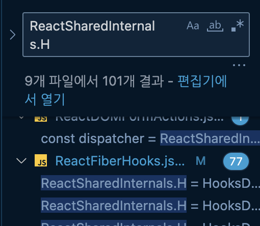
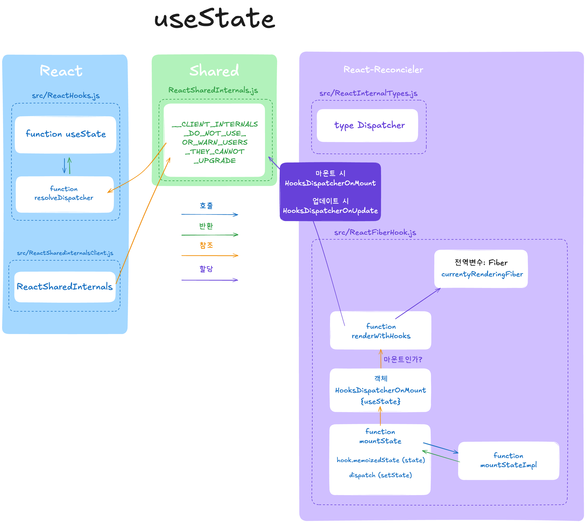

<Heading type="h2">React Hooks 톺아보기</Heading>

이전에 `useState` 호출 시 일어나는 로직까지 알아봤다.
오늘은 정말로 `useState`의 동작원리에 대해 알아보자. `*Let's get it*`

<Heading type="h3">이전 복습</Heading>

1. React에서 useState를 호출하면 `ReactHooks.js`에서 가져온다.
2. `ReactHooks.js` 안에 `resolveDispatcher()` 함수에서 `Hook` 객체 정보가 담긴 `dispatcher`를 가져오는데 **shared** 폴더에서 `ReactSharedInternals`라는 객체를 가져와서 사용한다.
3. 이때 `ReactSharedInternals`는 **react-reconciler**라는 곳에서 `dispatcher` 타입을 참조하고 값은 **React**에서 `ReactSharedInternalsClient`에서 값을 가져온다.
4. 여기서 `ReactSharedInternals.H`은 분명 `null`값이었는데 `resolveDispatcher()`에선 dispatcher를 반환하기에 `Hook`들을 사용할수 있다. 객체값이 바뀐 이유가 있을것이고 오늘은 그 원인을 찾을 것이다.

<Heading type="h3">🤗 복기</Heading>

분명 어딘가에서 `ReactSharedInternals.H`를 건드린 것이 분명하니 찾아보자.



심상치 않은 녀석이 있다. 이녀석이 `null`에 `dispatcher`를 주입한 녀석일 것이다.
`ReactFiberHooks.js`로 가보자.

**packages/react-reconciler/src/ReactFiberHook.js**

그전에 잠깐 **Fiber**가 뭘까??

<Heading type="h3">Fiber</Heading>

피버라고 부르는 줄 알았는데 **파이버**라고 읽나보다.(화이바..?)
Fiber는 React Ver16 버전부터 도입된 React에 작업을 분류하여 우선순위를 정하고 **더 높은 우선순위를 가진 작업이 요청될 경우 기존 작업을 일시정지** 후 우선된 작업이 종료된 후에는 **기존 작업으로 돌아가거나 완전히 중단**시키는 **재조정자(reconciler) 아키텍쳐**다. 보통 React의 VDOM에서 이전 상태값과 현재 상태값을 저장하고 있는 노드라고 생각하면된다.

의미로만 본다면 useState가 호출되면 `ReactSharedInternals`를 가져올 때 중간에 값을 변경시키는 역할도 하지 않았을까 예상해본다. 아님말고. 일단 가보자.

<Heading type="h3">ReactFiberHook.js</Heading>

```ts
...
// 역시 shared/ReactSharedInternals에서 가져왔다.
import ReactSharedInternals from 'shared/ReactSharedInternals';
...
// react 작업에 따라 Dispatcher를 담는 객체들이 있다.
let HooksDispatcherOnMountInDEV: Dispatcher | null = null;
let HooksDispatcherOnMountWithHookTypesInDEV: Dispatcher | null = null;
let HooksDispatcherOnUpdateInDEV: Dispatcher | null = null;
let HooksDispatcherOnRerenderInDEV: Dispatcher | null = null;
let InvalidNestedHooksDispatcherOnMountInDEV: Dispatcher | null = null;
let InvalidNestedHooksDispatcherOnUpdateInDEV: Dispatcher | null = null;
let InvalidNestedHooksDispatcherOnRerenderInDEV: Dispatcher | null = null;

...

ReactSharedInternals.H = HooksDispatcherOnUpdateInDEV;
...
ReactSharedInternals.H = HooksDispatcherOnMountWithHookTypesInDEV;
...
ReactSharedInternals.H =
      current === null || current.memoizedState === null
        ? HooksDispatcherOnMount
        : HooksDispatcherOnUpdate;
...
```

**ReactFiberHook.js**에서 `ReactSharedInternals.H` 상황에 따라 다양하게 `Hook`값을 변경하고 있다.

그 중 찾았다.

```ts
// 마운트 될 때 들어갈 Hooks Dispatcher 값
const HooksDispatcherOnMount: Dispatcher = {
  readContext,

  use,
  useCallback: mountCallback,
  useContext: readContext,
  useEffect: mountEffect,
  useImperativeHandle: mountImperativeHandle,
  useLayoutEffect: mountLayoutEffect,
  useInsertionEffect: mountInsertionEffect,
  useMemo: mountMemo,
  useReducer: mountReducer,
  useRef: mountRef,
  useState: mountState,
  useDebugValue: mountDebugValue,
  useDeferredValue: mountDeferredValue,
  useTransition: mountTransition,
  useSyncExternalStore: mountSyncExternalStore,
  useId: mountId,
};
// 업데이트 될 때 들어갈 Hooks Dispatcher 값
const HooksDispatcherOnUpdate: Dispatcher = {
  readContext,

  use,
  useCallback: updateCallback,
  useContext: readContext,
  useEffect: updateEffect,
  useImperativeHandle: updateImperativeHandle,
  useInsertionEffect: updateInsertionEffect,
  useLayoutEffect: updateLayoutEffect,
  useMemo: updateMemo,
  useReducer: updateReducer,
  useRef: updateRef,
  useState: updateState,
  useDebugValue: updateDebugValue,
  useDeferredValue: updateDeferredValue,
  useTransition: updateTransition,
  useSyncExternalStore: updateSyncExternalStore,
  useId: updateId,
};
```

우리가 볼것은 `HooksDispatcherOnMount` 마운트 될 때 Hook이 담기는 부분을 보면 된다.

수많은 함수 중 `ReactSharedInternals.H = HooksDispatcherOnMount` 를 사용하는 함수는 두개

`renderWithHooks`와 `useThenable` 함수
`useThenable`함수의 경우는 **ReactFiberHook.js**내에서 Fiber의 동작 로직 중 하나로 보인다.

`renderWithHooks()`를 살펴보자

<Heading type="h4">renderWithHooks()</Heading>

```ts
//renderWithHooks()
export function renderWithHooks<Props, SecondArg>(
  current: Fiber | null, // 업데이트 전
  workInProgress: Fiber, // 업데이트를 하기 위한 hook
  Component: (p: Props, arg: SecondArg) => any,
  props: Props,
  secondArg: SecondArg,
  nextRenderLanes: Lanes,
): any {
  renderLanes = nextRenderLanes;
  currentlyRenderingFiber = workInProgress;

  if (__DEV__) {
    hookTypesDev =
      current !== null
        ? ((current._debugHookTypes: any): Array<HookType>)
        : null;
    hookTypesUpdateIndexDev = -1;
    // Used for hot reloading:
    ignorePreviousDependencies =
      current !== null && current.type !== workInProgress.type;

    warnIfAsyncClientComponent(Component);
  }

  workInProgress.memoizedState = null;
  workInProgress.updateQueue = null;
  workInProgress.lanes = NoLanes;

  ...

  if (__DEV__) {
    // 개발 로직.
    if (current !== null && current.memoizedState !== null) {
      ReactSharedInternals.H = HooksDispatcherOnUpdateInDEV;
    } else if (hookTypesDev !== null) {
      ...
      ReactSharedInternals.H = HooksDispatcherOnMountWithHookTypesInDEV;
    } else {
      ReactSharedInternals.H = HooksDispatcherOnMountInDEV;
    }
  } else {
    ReactSharedInternals.H =
      current === null || current.memoizedState === null
        ? HooksDispatcherOnMount
        : HooksDispatcherOnUpdate;
  }

  ...
  // 개발 환경에서 두번 리렌더링이 필요한지 확인
  const shouldDoubleRenderDEV =
    __DEV__ &&
    debugRenderPhaseSideEffectsForStrictMode &&
    (workInProgress.mode & StrictLegacyMode) !== NoMode;

  shouldDoubleInvokeUserFnsInHooksDEV = shouldDoubleRenderDEV;
  let children = __DEV__
    ? callComponentInDEV(Component, props, secondArg)
    : Component(props, secondArg);
  shouldDoubleInvokeUserFnsInHooksDEV = false;

  /**
	 렌더 패스 중에만 업데이트가 예약된 경우 시도할 때 마다 재설정되는
	값으로 didScheduleRenderPhaseUpdate 나 numberOfReRenders을 이용해
	통합할 수 있는 방법이 있어보인다. 라는 것을 미루어볼 때 굳이 신경쓸 필요는 없는
	친구로 보인다.
  */
  if (didScheduleRenderPhaseUpdateDuringThisPass) {
    // 아래 함수도 공부할 로직에 당장 영향을 주진 않는다
    children = renderWithHooksAgain(
      workInProgress,
      Component,
      props,
      secondArg,
    );
  }

  if (shouldDoubleRenderDEV) {
    // In development, components are invoked twice to help detect side effects.
    setIsStrictModeForDevtools(true);
    try {
      children = renderWithHooksAgain(
        workInProgress,
        Component,
        props,
        secondArg,
      );
    } finally {
      setIsStrictModeForDevtools(false);
    }
  }
  // 모든 hook 계산 로직들을 수행한 이후 기존에 사용하던 객체들을 비우는 작업을
  // 수행한다. 이것도 크게 신경 쓸 필요는 없다.
  finishRenderingHooks(current, workInProgress, Component);

  return children;
}

```

새로운 hook정보가 담긴 `workInProgress`가 `currentlyRenderingFiber`에 담기는 것을 볼 수 있다.

```js
currentlyRenderingFiber = workInProgress;
```

`currentlyRenderingFiber`가 무엇인가 보면

<Heading type="h4">currentlyRenderingFiber</Heading>

```js
// The work-in-progress fiber. I've named it differently to distinguish it from
// the work-in-progress hook.
let currentlyRenderingFiber: Fiber = (null: any);
```

`currentlyRenderingFiber`는 `Fiber` 타입의 객체이다.

`React Reconciler` 내에 전역변수로서 선언되어 있다.
개발자 주석에는 진행중인 hook과 이름을 일부러 다르게 지었다고 설명하고 있다.

그럼 `currentlyRenderingFiber`에 어떤 값을 저장을 하나?

`Fiber` 타입을 살펴보면

```ts
export type Fiber = {

  ...

  // The state used to create the output
  memoizedState: any,

  ...

};
```

이 `Fiber`는 현재의 hook과 비교되는 저장된 `Fiber` 객체로 현재 `React` 같은 상태관리 Hook의 state가 저장되는 곳이다.

계속 보자

```js
// 매개변수 객체를 직접 수정하는 케이스
workInProgress.memoizedState = null;
workInProgress.updateQueue = null;
```

해당 함수에서 매개변수인 `workInProgress` 객체는 참조형 자료 타입이기 때문에 안에 있는 값을 직접 수정할 수 있다.

```ts
ReactSharedInternals.H =
  current === null || current.memoizedState === null
    ? HooksDispatcherOnMount
    : HooksDispatcherOnUpdate;
```

`ReactSharedInternals`의 `H(Hook)`은 `Dispatcher` 타입을 참조하고 있다.
그리고 `current`는 매개변수로 `Fiber` 타입이다.
그러니 `current === null || current.memoizedState === null` 이 두 조건이 **mount**되는 조건으로
`HooksDispatcherOnMount`를 넘겨주고 mount 조건이 아니면 update에 대한 dispatcher(HooksDispatcherOnUpdate)를 넘겨주는 것을 볼 수 있다.

<Heading type="h4">HooksDispatcherOnMount</Heading>

`HooksDispatcherOnMount`의 타입을 보면

```ts
const HooksDispatcherOnMount: Dispatcher = {
  readContext,

  use,
  useCallback: mountCallback,
  useContext: readContext,
  useEffect: mountEffect,
  useImperativeHandle: mountImperativeHandle,
  useLayoutEffect: mountLayoutEffect,
  useInsertionEffect: mountInsertionEffect,
  useMemo: mountMemo,
  useReducer: mountReducer,
  useRef: mountRef,
  useState: mountState,
  useDebugValue: mountDebugValue,
  useDeferredValue: mountDeferredValue,
  useTransition: mountTransition,
  useSyncExternalStore: mountSyncExternalStore,
  useId: mountId,
};
```

이렇게 `Hook`들이 객체에 담겨 있고 우리는 오늘 `useState`만 볼거다.
`useState`에는 `mountState`라는 게 담겨 있다. `HooksDispatcherOnUpdate`에는 `useState`에 `updateState`라는 게 담겨있다.
먼저 `mountState`에 가보자.

<Heading type="h4">mountState</Heading>

```ts
function mountState<S>(
  initialState: (() => S) | S,
): [S, Dispatch<BasicStateAction<S>>] {
  const hook = mountStateImpl(initialState);
  const queue = hook.queue;
  const dispatch: Dispatch<BasicStateAction<S>> = (dispatchSetState.bind(
    null,
    currentlyRenderingFiber,
    queue,
  ): any);
  queue.dispatch = dispatch;
  return [hook.memoizedState, dispatch];
}
```

`mountState`는 함수였다. 그리고 우리가 아는 `useState`가 함수라면 이렇게 생겼겠다 싶은 함수다.
코드를 분석해 보자.

```ts
const hook = mountStateImpl(initialState);
```

우리는 `useState`를 사용할 때 `initialState`값을 넣어준다.
그 값을 매개 변수로 받아서 `mountStateImpl`함수에 넣어주는데 왜 넣어주는 지 또 코드로 가봐야한다.

<Heading type="h4">mountStateImpl</Heading>

`Impl`이 무엇일까?
디자인 패턴 중 하나로 어댑터 패턴이라고 부르며
구현체는 최대한 `Impl`에 몰아넣고 실제로 사용할 로직과 분리하는 것을 말한다.

```ts
function mountStateImpl<S>(initialState: (() => S) | S): Hook {
  const hook = mountWorkInProgressHook();
  if (typeof initialState === 'function') {
    const initialStateInitializer = initialState;
    // $FlowFixMe[incompatible-use]: Flow doesn't like mixed types
    initialState = initialStateInitializer();
    if (shouldDoubleInvokeUserFnsInHooksDEV) {
      setIsStrictModeForDevtools(true);
      // $FlowFixMe[incompatible-use]: Flow doesn't like mixed types
      initialStateInitializer();
      setIsStrictModeForDevtools(false);
    }
  }
```

여기서도 hook을 `mountWorkInProgressHook`에서 반환된 값을 가져온다.

<Heading type="h4">mountWorkInProgressHook</Heading>

```ts
function mountWorkInProgressHook(): Hook {
  const hook: Hook = {
    memoizedState: null,

    baseState: null,
    baseQueue: null,
    queue: null,

    next: null,
  };

  if (workInProgressHook === null) {
    // This is the first hook in the list
    currentlyRenderingFiber.memoizedState = workInProgressHook = hook;
  } else {
    // Append to the end of the list
    workInProgressHook = workInProgressHook.next = hook;
  }
  return workInProgressHook;
}
```

코드를 보면 hook이란 객체를 초기화 해주고 `workInProgressHook` 값이 `null`이라면 위에서 언급한 `currentlyRenderingFiber`의 `memoizedState`값과 `workInProgressHook`에 초기화된 `hook` 객체를 넣어준다.
아니라면 `workInProgressHook`과 `workInProgressHook.next`에 `hook`을 넣어주는 로직이라고 보인다.

`hook` 객체는 `Hook` 타입이 명시되어 있는데

```ts
export type Hook = {
  memoizedState: any;
  baseState: any;
  baseQueue: Update<any, any> | null;
  queue: any;
  next: Hook | null;
};
```

`memoizedState`는 위 `mountState`에서 반환하는 첫번째 값. `hook.memoizedState`.

`useStaet`로 예를 들면

```ts
const [state, setState] = useStaet(0);
```

에서 렌더링 시 노출되는 값 `state`이다.

그리고 baseState는 `mountState`에서 반환하는 두번째 값 `dispatch` 그 타입은 `Dispatch<BasicStateAction<S>>`를 명시하고 있다.
쉽게 말해 기본 값이라는 건데
`useStae`의 `setState`는 콜백함수를 인자로 받을 수 있다.

```ts
setState((prev) => prev);
```

여기서 `prev`가 `baseState`라는 것을 알 수 있다.

<Heading type="h3">📚 마무리</Heading>



생각보다 `useState` 분석이 길어지고 있다. 자주 쓰는 `Hook`이라고 많이 얕봤던 것
같다. 그래도 코드를 보며 `useState`의 동작 원리에 대해 이해가 되고 있으니 재밌다는 생각이 든다.
언른 분석을 끝내고 다음 `Hook`도 알아보고 싶어졌다.
